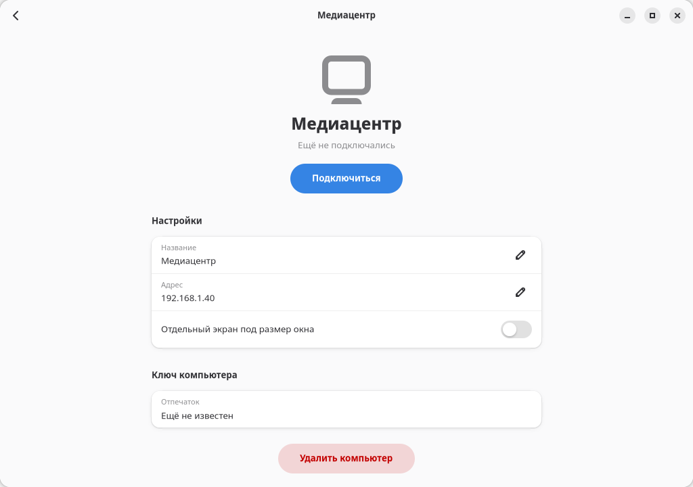

<div align="center">

# Casement

**Удалённый рабочий стол для своей сети: локальной или Tailscale**

[](https://github.com/Cheviiot/Casement/actions/workflows/build.yml)
[](https://github.com/Cheviiot/Casement/releases/latest)
[](LICENSE)


</div>

Casement показывает экран другого компьютера и даёт управлять им мышью и клавиатурой.
Компьютеры соединяются напрямую: в локальной сети или через
[Tailscale](https://tailscale.com), без серверов-посредников, учётных записей и облака.
Одно приложение и подключается к другим, и пускает к себе.

## Возможности

- Экран в H.264 с аппаратным кодированием (VA-API на Linux; AMD, Intel, NVIDIA или
  Media Foundation на Windows), мышь, колесо и клавиатура.
- Звук того компьютера с кнопкой «выключить звук».
- Общий буфер обмена для текста в обе стороны.
- Файлы в обе стороны: отправка кнопкой или перетаскиванием на экран, просмотр папок
  того компьютера и скачивание. Целостность проверяется по SHA-256.
- Выбор монитора, если их несколько. На GNOME можно попросить отдельный виртуальный
  экран ровно под размер окна, он меняется вместе с окном.
- Компьютеры с Casement в локальной сети находятся сами (mDNS); через Tailscale
  подключение идёт по имени.
- Автоматическое переподключение при обрыве связи.

## Установка

Все файлы — в [последнем релизе](https://github.com/Cheviiot/Casement/releases/latest).

### Windows 10 и 11

Скачайте и запустите
[`casement-windows-x86_64-setup.exe`](https://github.com/Cheviiot/Casement/releases/latest/download/casement-windows-x86_64-setup.exe).
Мастер установки поставит Casement в Program Files, добавит в меню «Пуск», разрешит
входящие подключения в частных сетях и появится в «Установка и удаление программ».
Без установки — архив `-portable.zip`: распакуйте и запустите `bin\casement.exe`.

### Linux

| Система | Пакет | Установка |
|---|---|---|
| ALT p11 | `casement-*-alt1.x86_64.rpm` | `su - -c 'apt-get install ./casement-*.rpm'` |
| Fedora 44 | `casement-*.fc44.x86_64.rpm` | `sudo dnf install ./casement-*.rpm` |
| Debian 13, Ubuntu 25.04+ | `casement_*_amd64.deb` | `sudo apt install ./casement_*.deb` |
| Любой дистрибутив | `casement-*-x86_64.flatpak` | `flatpak install --user ./casement-*.flatpak` |

Пакеты сами подтягивают GTK, Libadwaita и плагины GStreamer. Без root можно поставить
в домашнюю папку:

```sh
curl -fsSL https://github.com/Cheviiot/Casement/releases/latest/download/install.sh | sh
```

Чтобы пускать к себе, нужен GNOME на Wayland. Во Flatpak подключения принимаются,
пока открыто окно Casement; в остальных пакетах — и без окна, службой
`casement-host`, которую включает переключатель «Принимать подключения».

> Для обновления поставьте новую версию поверх. Настройки сохраняются.

## Как пользоваться

1. На компьютере, к которому будете подключаться, откройте **Этот компьютер**, задайте
   **Пароль доступа** и включите **Принимать подключения**.
2. На своём компьютере выберите его в разделе **В этой сети** или введите адрес либо
   имя в Tailscale в поле **Подключиться**.
3. При первом входе введите пароль. Дальше устройство считается доверенным и входит
   без пароля.

<div align="center">

</div>

## Безопасность

- Соединение — QUIC с TLS 1.3. У каждого устройства свой ключ Ed25519, он не покидает
  `device.key`.
- Пароль доступа проверяется по OPAQUE: он не передаётся по сети, а на компьютере
  хранится только запись, по которой войти нельзя. Перебор ограничен паузами.
- Ключ нового компьютера запоминается при первом подключении. Если у знакомого
  компьютера ключ сменится, подключение остановится и спросит, что делать.
- По умолчанию принимаются подключения только из частных сетей и Tailscale (UDP 47820).

## Командная строка

`casement-cli` нужен для проверок и для компьютеров без графического сеанса:

```sh
casement-cli password set                 # пароль доступа этого компьютера
casement-cli listen                       # принимать подключения из терминала
casement-cli discover                     # компьютеры с Casement в сети
casement-cli connect office --record a.h264 --frames 120  # записать экран в файл
casement-cli connect office --send отчёт.pdf              # отправить файл
```

## Ограничения

- Пустить к себе на Linux можно только из сеанса GNOME на Wayland: экран и ввод идут
  через Mutter. Экран входа в систему не показывается.
- На Windows не показываются окна UAC и экран входа: для этого нужна системная служба.
- macOS и Android пока не поддерживаются.

## Сборка

Как собрать и проверить из исходников, в [docs/DEVELOPMENT.md](docs/DEVELOPMENT.md).
Устройство программы описано в [docs/ARCHITECTURE.md](docs/ARCHITECTURE.md).

## Лицензия

[MIT](LICENSE).
