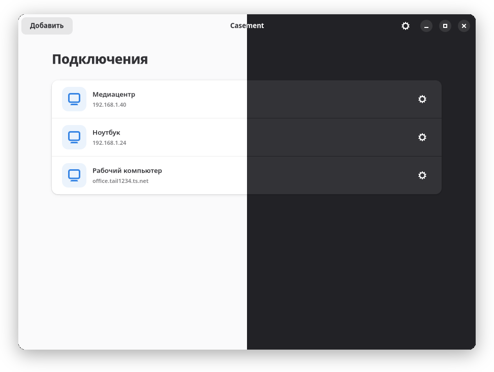

<div align="center">


# Casement

**Удалённый рабочий стол для своей сети — локальной или Tailscale.**

Русский · [English](README.md)

[](https://github.com/Cheviiot/Casement/actions/workflows/build.yml)
[](https://github.com/Cheviiot/Casement/releases/latest)
[](LICENSE)



[](https://github.com/Cheviiot/Casement/releases/latest/download/casement-windows-x86_64-setup.exe)
[](https://github.com/Cheviiot/Casement/releases/latest/download/casement-alt-p11.x86_64.rpm)
[](https://github.com/Cheviiot/Casement/releases/latest/download/casement-fedora.x86_64.rpm)
[](https://github.com/Cheviiot/Casement/releases/latest/download/casement_amd64.deb)
[](https://github.com/Cheviiot/Casement/releases/latest/download/casement-linux-x86_64.run)

</div>

## Почему Casement

- **Напрямую.** Компьютеры соединяются через вашу локальную сеть или Tailscale — без
  серверов-посредников, учётных записей и облака.
- **Быстро.** Аппаратный H.264 поверх QUIC: около 26 мс от движения мыши до нового кадра
  в домашней сети.
- **Всё нужное.** Экран, мышь и клавиатура, звук, буфер обмена, файлы в обе стороны,
  несколько мониторов, автоматическое переподключение.
- **Надёжно.** TLS 1.3 и свой ключ у каждого устройства; пароль доступа проверяется по
  OPAQUE и не покидает компьютер.
- **Нативно.** Одно приложение на GTK 4 и Libadwaita для Linux и Windows: и подключается,
  и пускает к себе.

## Начать

1. Поставьте Casement на оба компьютера. Приём подключений включён сразу.
2. На компьютере, к которому будете подключаться, задайте пароль доступа:
   **Настройки → Пароль доступа** или `casement-cli setup` в терминале.
3. На своём компьютере нажмите **Добавить**: выберите **В локальной сети** или
   **По адресу**. Затем нажмите строку подключения. Пароль нужен один раз,
   дальше устройство доверенное.

## Без графики

```sh
~/.local/opt/casement/current/bin/casement-cli setup
~/.local/opt/casement/current/bin/casement-cli status
~/.local/opt/casement/current/bin/casement-cli accept off
```

## Требования

- **Windows** 10 или 11. Casement работает как служба, поэтому показывает и экран входа, и экран
  блокировки, и окна UAC.
- **Linux x86-64.** Универсальный `.run` содержит GTK, Libadwaita и GStreamer и ставится
  без `sudo` в `~/.local/opt/casement`. Чтобы пускать к себе, нужен GNOME на Wayland.

Все файлы — в [последнем релизе](https://github.com/Cheviiot/Casement/releases/latest),
в том числе переносные архивы и единый Linux-установщик `.run`.

## Подробнее

[Как устроено](docs/ARCHITECTURE.md) · [Сборка и проверки](docs/DEVELOPMENT.md) ·
[Лицензия MIT](LICENSE)
